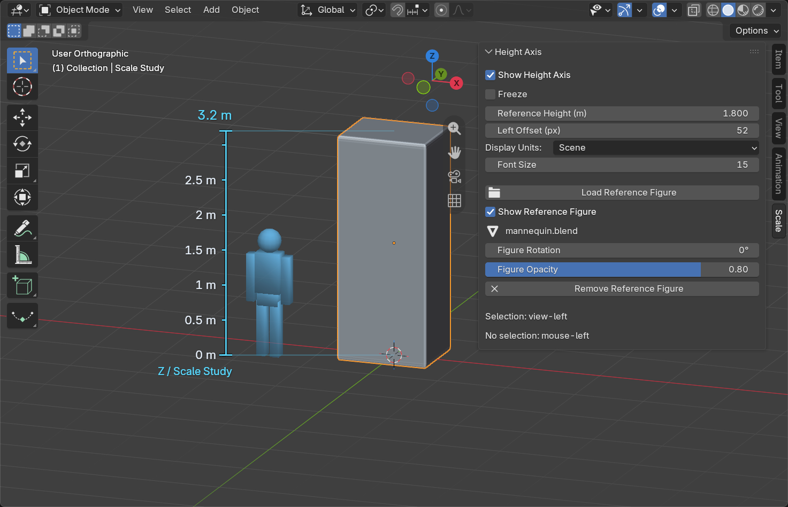

# Height Axis for Blender

A viewport height ruler and reference figure that stay on the **view-left side** of your selection or mouse. Freeze them wherever you want a lasting scale reference.

**English** · [简体中文](#简体中文)

[Download the latest release](https://github.com/taoluo20/blender-height-axis/releases/latest) · [Visual guide](docs/VISUAL_GUIDE.md) · [Features and behavior](docs/FEATURES_AND_LOGIC.md) · [Build and test](docs/DEVELOPMENT.md)

## Three placement states

| State | Ruler and figure behavior |
| --- | --- |
| **Selection** | Measure the visible selected geometry's world-Z height. Keep the guides to its screen-left as you orbit the viewport. Multi-selection measures the combined height. |
| **Mouse** | With nothing selected, follow the mouse on the left. The reference height defaults to **1.8 m**. |
| **Frozen** | Pin the displayed ruler and figure in **world space**. Mouse movement, selection changes and viewport orbit no longer reposition them. Uncheck **Freeze** to resume following. |

The reference figure keeps its configured physical height, so a 1.8 m person can be compared with a 3.2 m object. It is not stretched to match the target.

## Install and use

1. Download `height-axis-1.2.1.zip` from [Releases](https://github.com/taoluo20/blender-height-axis/releases/latest).
2. In Blender, open **Edit → Preferences → Get Extensions → menu → Install from Disk**, select the ZIP, and enable **Height Axis**.
3. In the 3D Viewport press **N**, open **Scale**, and enable **Show Height Axis**.

Use **Load Reference Figure** to choose a `.blend`, `.fbx`, `.obj`, `.gltf`, `.glb` or `.stl` model. Adjust **Reference Height (m)**, **Figure Rotation** and **Figure Opacity**. The figure has its own display checkbox.

Enable **Freeze** to preserve the current placement. In mouse mode you can move into the sidebar to click it: the last visible viewport placement is retained. Placement and reference data save with the `.blend` file.

The interface uses English source labels and includes Simplified Chinese translations through Blender's language settings. Display and Freeze are off by default. Hiding viewport Overlays hides the guides.

## What is included

- Live evaluated geometry bounds, including object transforms and mesh modifiers.
- World-Z height for combined selections; live edit-mesh bounds in Edit Mode.
- Adaptive ruler ticks and scene units, or explicit m / cm / mm / ft / in.
- A shaded blue reference figure, independent from the scene's selectable objects and final render.
- Model import with replacement, failure recovery, reference-only display and saved-file persistence.
- World-space Freeze for both selection and mouse placement.
- No added hotkeys or network service dependency.

## Compatibility and limits

The manifest declares **Blender 4.5+**. Integration checks were run on **5.1.2** and **5.2.2 LTS**; viewport checks and publication screenshots use 5.2.2. See [validation details](docs/VALIDATION.md).

- Height follows **world Z**, not an object's local axis. In Edit Mode the editable mesh is measured before final modifiers.
- Unrealized instances are not included in the selection height. Realize or convert them first when needed.
- Mouse placement uses a view-depth plane through the 3D Cursor; it does not automatically snap to the surface under the pointer.
- Near a top/bottom view, a live Z ruler may use a labelled **diagram** when its vertical projection collapses. Its number remains the measured height.
- Reference models use a single blue shaded style, with no source textures or animation playback. Hidden/non-rendering meshes and bone widgets are excluded. Large references are simplified to a display budget of about 150,000 triangles.
- Import requires Object Mode. Loading a new model successfully resumes following; removing a figure leaves a frozen ruler in place.
- Guides can be clipped at viewport edges. Frozen positions naturally change screen projection when the camera moves.

## Documentation

The repository keeps the extension in `height_axis/`, public guides and previews in `docs/`, portable checks in `tests/`, and build tools in `tools/`. Generated installers are distributed through Releases.

- [Visual guide](docs/VISUAL_GUIDE.md): controls, colors and examples.
- [Features and logic](docs/FEATURES_AND_LOGIC.md): state transitions, measurement rules and persistence.
- [Development](docs/DEVELOPMENT.md): reproducible packages and isolated Blender checks.
- [Changelog](CHANGELOG.md) · [License](LICENSE): GPL-3.0-or-later.

The preview mannequin is generated by this project's tests. No third-party character asset is bundled.

---

## 简体中文

Height Axis 是 Blender 的视口高度尺与参考人物工具。参照始终位于选中物体或鼠标点的**当前视口左侧**，也可以冻结在需要保留的三维位置。

### 三种放置状态

| 状态 | 尺子与人物的行为 |
| --- | --- |
| **选中物体** | 测量可见选中几何体的世界 Z 高度；旋转视口时仍位于其屏幕左侧。多选计算整体高度。 |
| **鼠标跟随** | 未选中物体时，在鼠标左侧跟随。默认参考高度为 **1.8 米**。 |
| **冻结** | 将当时显示的尺子和人物固定在**世界三维位置**。移动鼠标、改变选择及旋转视口都不会重新放置它们；取消勾选 Freeze 后恢复跟随。 |

参考人物始终使用设置的真实身高，例如用 1.8 米人物对比 3.2 米物体，不会自动拉伸成目标物体的高度。

### 安装与使用

1. 从 [Releases](https://github.com/taoluo20/blender-height-axis/releases/latest) 下载 `height-axis-1.2.1.zip`。
2. 在 Blender 打开 **Edit → Preferences → Get Extensions → 右上角菜单 → Install from Disk**，选择 ZIP 并启用 Height Axis。
3. 3D 视口按 **N**，打开 **Scale** 页签，勾选 **Show Height Axis / 显示高度轴**。

点击 **Load Reference Figure / 加载参考人物**，选择 Blend、FBX、OBJ、glTF/GLB 或 STL 文件。可调整参考身高、人物朝向和不透明度；人物有独立显示开关。

勾选 **Freeze / 停止跟随** 即固定位置。未选中时，将鼠标移入侧栏点击也能保留该视口最后显示的参照位置。冻结位置和参考数据随 `.blend` 保存。

界面以英文为源语言，包含随 Blender 语言设置使用的简体中文翻译。默认关闭显示与冻结；关闭视口 Overlays 时参照也会隐藏。

### 功能与边界

支持变换和网格修改器后的实时高度、多选整体高度、编辑网格、自动刻度、场景单位及 m / cm / mm / ft / in。参考人物采用蓝色立体参照显示，可替换、独立开关并随文件保存，不注册额外快捷键，不依赖网络服务。

清单声明 Blender 4.5+；实际检查版本为 **5.1.2** 和 **5.2.2 LTS**，视口验证和公开预览使用 5.2.2。详见[验证记录](docs/VALIDATION.md)。

- 高度按世界 Z 轴测量。编辑模式读取修改器之前的当前编辑网格。
- 未实体化实例不计入选中高度，需要时先 Realize Instances 或转换为实际几何体。
- 鼠标参照使用穿过 3D Cursor 的视图深度平面，不自动贴合鼠标下方表面。
- 俯视或仰视时，实时高度尺可能显示标有 diagram 的示意尺，数值仍为实际高度。
- 人物不使用原贴图、不播放动画；隐藏或不可渲染的网格及骨骼控制形状会排除。大型模型会简化为约 15 万三角面的显示参照。
- 加载需要对象模式。成功加载新模型会恢复跟随；移除人物时，冻结的尺子仍保留原位置。
- 视口边缘可能裁切参照；冻结后的参照会随相机移动自然改变屏幕投影。

更多内容：[视觉指南](docs/VISUAL_GUIDE.md)、[功能与逻辑](docs/FEATURES_AND_LOGIC.md)、[构建与测试](docs/DEVELOPMENT.md)、[更新记录](CHANGELOG.md)。许可证为 GPL-3.0-or-later。预览人物由本项目测试脚本生成，没有打包第三方人物资产。

项目结构：`height_axis/` 为扩展源码，`docs/` 为公开指南与预览，`tests/` 为可移植检查，`tools/` 为构建脚本。生成的安装包通过 Releases 分发。
