# Features and Placement Logic

**English** · [简体中文](#简体中文)

## State model

```mermaid
stateDiagram-v2
    [*] --> Hidden
    Hidden --> Selection: Enable an unfrozen guide with geometry selected
    Hidden --> Mouse: Enable an unfrozen guide with no selection
    Hidden --> Frozen: Show a guide with a retained Freeze
    Selection --> Mouse: Deselect geometry
    Mouse --> Selection: Select geometry
    Selection --> Frozen: Check Freeze
    Mouse --> Frozen: Check Freeze
    Frozen --> Selection: Uncheck Freeze with a selection
    Frozen --> Mouse: Uncheck Freeze without a selection
    Selection --> Hidden: Disable both guides
    Mouse --> Hidden: Disable both guides
    Frozen --> Hidden: Disable both guides; keep placement
```

The display checkboxes and placement are independent. Hiding both guides can retain a frozen placement; showing a guide again restores that placement. A viewport with no previous visible guide cannot create a meaningful Freeze and displays a hint instead.

## Selection placement

1. Collect the visible selected geometric objects.
2. Measure their combined minimum and maximum **world Z** using evaluated vertices. In Edit Mode use the current editable mesh.
3. Project the bounds into the active viewport and place the guides beyond the left edge in screen space.
4. Recalculate that placement as the view rotates. The configured figure height remains constant.

Only supported geometry is measured; cameras, lights, Empty helpers and armatures themselves are excluded. The ruler starts at zero at the geometry's lowest point.

## Mouse placement

With no selection, the ruler and figure follow the mouse in the active 3D viewport. The whole figure stays left of the pointer with a configurable gap. Its height is specified in physical metres, converted through the scene's unit scale.

The anchor is calculated at the view depth of the 3D Cursor. Entering the sidebar or another editor hides the live mouse guide. The last displayed position is cached so clicking Freeze in the sidebar captures the intended location.

## Freeze

Freeze captures the displayed ruler endpoints and tick positions in world space, together with the figure's complete transform and height. It does not attach those positions to the selected object. Each viewport projects the same stored geometry through its own camera.

While frozen, geometry-changing controls are disabled. Units, font size, opacity and visibility remain editable. The snapshot, display settings and baked reference mesh persist in the scene when the blend file is saved. Unfreezing clears the snapshot and resumes the current selection or mouse placement. A successful new model import also resumes following; an unsuccessful import preserves the existing reference.

## Reference loading

Import occurs in a temporary scene. The evaluated visible surfaces are combined, optional axis correction is applied, large references are simplified, and the result is normalized to unit height. The normalized display mesh is retained as scene data; the temporary objects, rigs, materials and import data are removed. The original scene selection and active object are restored.

The viewport draws this reference with its own depth buffer and a blue shaded style. It has no selectable scene object and does not appear in a render. Native format importers are used for Blend, FBX, OBJ, glTF/GLB and STL.

## Interaction rules

- Native selection, navigation and transforms receive their normal events.
- No hotkeys are registered.
- Freeze stops mouse tracking while preserving display.
- Loading or removing a reference is undoable; cached drawing data is cleared after undo/redo.
- Disabling the extension removes its handlers, timer, draw callback, classes and GPU resources. Stored scene values can remain in a saved blend file for later use.

---

## 简体中文

### 状态与放置

参照有隐藏、选中物体跟随、鼠标跟随及冻结四种状态。上方状态图展示其切换关系。显示开关与放置方式独立：隐藏参照时可以保留冻结位置，重新显示后恢复原位置。视口里从未显示过参照时，无法凭空冻结，界面会提示先显示尺子或人物。

选中时，收集可见的选中几何体，计算评估顶点在世界 Z 轴上的整体范围，再投影至当前视口，将参照放在屏幕左边缘之外。旋转视口会重新计算左侧位置；人物保持设置的参考身高。编辑模式读取当前编辑网格。尺子最低点从 0 开始，不测量海拔；相机、灯光、Empty 和骨架本体不参与高度测量。

未选中时，以 3D Cursor 的视图深度为基础计算鼠标锚点，尺子和人物跟随当前 3D 视口内的鼠标，并保留左侧间隔。参考高度始终以米输入，再按场景单位缩放换算。鼠标进入侧栏或其他编辑器时，实时参照隐藏；会记住最后显示的位置，供侧栏 Freeze 捕获。

### 冻结

冻结保存尺子端点、刻度的世界坐标，以及人物完整变换与高度，不再绑定选中物体。每个视口通过自己的相机投影同一份固定几何位置。

冻结时锁定会改变参照几何形态的参数，仍可调整单位、字号、不透明度和显示开关。快照、显示设置及参考网格随场景保存。解除冻结后清除快照并恢复当前的选择或鼠标跟随。成功加载新模型也会恢复跟随；加载失败保留旧参照。

### 人物加载与交互

使用临时场景导入并评估可见表面，合并几何体，按需修正向上轴、简化大型模型，再归一化为单位高度。只保留显示用的参考网格数据，清理临时对象、骨架、材质等导入数据，并恢复原场景的选择和活动对象。

人物使用独立深度缓冲绘制蓝色立体参照，不产生可选中的场景物体，也不进入最终渲染。支持 Blend、FBX、OBJ、glTF/GLB、STL 原生导入器。

原生选择、导航及变换继续接收正常事件，不新增快捷键。冻结停止鼠标追踪但保留绘制。模型加载和移除支持撤销，撤销/重做后清理绘制缓存。禁用扩展时清理处理器、计时器、绘制回调、注册类和 GPU 资源；已保存场景中的参照数据可在以后继续使用。
