# Features and Placement Logic

**English** · [简体中文](#简体中文)

## State model

```mermaid
stateDiagram-v2
    [*] --> Hidden
    Hidden --> Selection: Enable an unfrozen guide with geometry selected
    Hidden --> Mouse: Enable a guide with no selection and selection-only off
    Hidden --> Frozen: Show a guide with a retained Freeze
    Selection --> Mouse: Deselect with selection-only off
    Selection --> Hidden: Deselect with selection-only on
    Mouse --> Hidden: Enable selection-only
    Mouse --> Selection: Select geometry
    Selection --> Frozen: Check Freeze
    Mouse --> Frozen: Check Freeze
    Frozen --> Selection: Uncheck Freeze with a selection
    Frozen --> Mouse: Uncheck Freeze without selection and selection-only off
    Frozen --> Hidden: Uncheck Freeze without selection and selection-only on
    Selection --> Hidden: Disable both guides
    Mouse --> Hidden: Disable both guides
    Frozen --> Hidden: Disable both guides; keep placement
```

The display checkboxes and placement are independent. **Only With Selection** defaults on and filters live guides unless visible measurable geometry is selected. Explicit Freeze placements and stored object attachments are unaffected. Hiding both guides can retain a frozen placement; showing a guide again restores that placement. A viewport with no previous visible guide cannot create a meaningful Freeze and displays a hint instead.

## Selection placement

1. Collect the visible selected geometric objects.
2. Measure their combined minimum and maximum **world Z** using evaluated vertices. In Edit Mode use the current editable mesh.
3. Use the horizontal bounds' half-diagonal as a stable envelope. Place a vertical world-space ruler and figure outside it along the viewport's horizontal left direction, with the configured physical width offset.
4. Ease position and orbit changes with frame-rate independent following, defaulting to a subtle 0.02 s response. The configured figure height and ruler's world-Z span remain constant. A negative width offset moves inward and can reduce surface clearance during orbit.

Only supported geometry is measured; cameras, lights, Empty helpers and armatures themselves are excluded. The ruler starts at zero at the geometry's lowest point.

## Mouse placement

With no selection and **Only With Selection** disabled, the ruler and optional figure follow the mouse in the active 3D viewport. No object or model caption is shown, including when reopening an old frozen mouse reference. The whole figure stays left of the pointer with a configurable gap. Its height is specified in physical metres, converted through the scene's unit scale.

In version 1.6.0, both the pointer and its screen-left offset are inverse-projected onto world Z=0. With no figure, the ruler base projects to the pointer's screen height and the configured pixel gap; a figure reserves additional space to the left. This avoids moving the projected base when enforcing zero height and is independent of the 3D Cursor. Ground intersections at the horizon, behind the view or outside the depth clipping range are skipped.

Enable **Ruler at Mouse Tip** to place the ruler base at the pointer instead of applying **Mouse Gap (px)**. It starts off, saves with the scene and applies only to live mouse placement. Selection measurements and object attachments stay view-left; Freeze retains its captured world position. With a figure visible, placement compensates its reserved width so the ruler base stays at the pointer.

When the view's orbit centre is below zero and every visible measurable object has its entire evaluated geometry below zero, release the zero-height constraint. Mouse height follows the view-depth plane through the orbit centre, while the left offset remains aligned in screen space. Hidden objects do not prevent this mode; an empty scene does not enable it. Returning to a constrained view immediately restores a zero-height base. Entering the sidebar or another editor hides the live mouse guide. The last displayed position is cached so clicking Freeze in the sidebar captures the intended location. Previously saved Freeze placements retain their stored world positions.

## Freeze

Freeze captures the displayed ruler endpoints and tick positions in world space, together with the figure's complete transform and height. It does not attach those positions to the selected object. Each viewport projects the same stored geometry through its own camera.

While frozen, geometry-changing controls are disabled. Units, font size, line width, line/text RGBA, font choice, figure opacity and visibility remain editable. The snapshot, display settings and baked reference mesh persist in the scene when the blend file is saved. Unfreezing clears the snapshot and resumes the current selection or mouse placement. A successful new model import also resumes following; an unsuccessful import preserves the existing reference.

By default only full height is labelled, to the screen-left of its projected mark. **Show Half-Height Value** optionally adds the physical midpoint text and remains editable while frozen. It does not remove the midpoint crossbar or alter minor tick density. Perspective views project the actual world midpoint rather than averaging screen endpoints. New Freeze snapshots store that midpoint; existing snapshots recover it from their world endpoints. Crowded labels reduce to full height, and offscreen marks do not create labels at the viewport edge.

Zoom fades decimal tick layers down to 1 mm. Auto units use projected density to select m, cm or mm; during a handoff only the dominant unit is drawn, at its transition opacity. Far and top views retain one full-height readout and a smaller object name. The same readout moves between midpoint and endpoint during the detail transition, without drawing duplicate text. Frozen guides retain these zoom-dependent display changes.

**Tick Spacing (px)** controls the minimum screen separation at which a decimal layer starts fading in. The default is 24 UI-scaled pixels, compared with the previous fixed 6-pixel threshold. Larger values show fewer minor ticks; a layer reaches full opacity at four times its fade threshold. Tick positions remain exact physical multiples, down to 1 mm. Spacing saves with the scene and can change while frozen: display ticks are regenerated along the stored world segment without changing the snapshot or figure transform. Endpoint, half-height and minor marks all extend horizontally only screen-left from the axis.

Appearance settings save with each scene. Local TTF, OTF and TTC fonts are loaded once and reused; font handles are released on file load and extension disable. Font files are external dependencies, so missing paths fall back to Blender's default font and display a panel warning. A failed font choice keeps the previous choice.

## Reference loading

[Object attachments](OBJECT_ATTACHMENTS.md), introduced in 1.4.0, store independent object pointers, display choices and appearance snapshots with retained immutable reference mesh IDs. New entries capture the half-height text checkbox; older records without that field preserve their historical visible half-height. Entries reuse the live layout/drawing path with their own animation/density keys. Live Freeze and selection-only filtering remain independent. Target geometry is evaluated again as it changes; hidden or missing targets are skipped. Removal acts on records and unowned normalized reference meshes, never on target objects.

Import occurs in a temporary scene. The evaluated visible surfaces are combined, optional axis correction is applied, large references are simplified, and the result is normalized to unit height. The normalized display mesh is retained as scene data; the temporary objects, rigs, materials and import data are removed. The original scene selection and active object are restored.

The viewport draws this reference with its own depth buffer and a neutral-gray shaded style. It has no selectable scene object and does not appear in a render. Native format importers are used for Blend, FBX, OBJ, glTF/GLB and STL.

## Interaction rules

- Native selection, navigation and transforms receive their normal events.
- No hotkeys are registered.
- Freeze stops mouse tracking while preserving display.
- Loading or removing a reference is undoable; cached drawing data is cleared after undo/redo.
- Disabling the extension removes its handlers, timer, draw callback, classes and GPU resources. Stored scene values can remain in a saved blend file for later use.

---

## 简体中文

### 状态与放置

参照有隐藏、选中物体跟随、鼠标跟随及冻结四种状态。上方状态图展示其切换关系。显示开关与放置方式独立：隐藏参照时可以保留冻结位置，重新显示后恢复原位置。视口里从未显示过参照时，无法凭空冻结，界面会提示先显示尺子或人物。

**仅选中时显示**默认开启，只有选中可见且可测量的几何体时才显示实时参照；已有显式冻结和物体绑定不受影响。跟随缓动默认 0.02 秒，保留轻微平滑。

选中时，收集可见的选中几何体，计算评估顶点在世界 Z 轴上的整体范围。以水平包围范围的半对角线构成稳定边界，沿视口水平左侧方向将三维竖直尺子与人物放在边界之外，并加入实际宽度偏移。位置与旋转变化使用与帧率无关的平滑跟随；人物身高及尺子的世界 Z 高度保持实际尺寸。负宽度偏移向内靠近，旋转时可能减少与表面的间隔。编辑模式读取当前编辑网格。尺子最低点从 0 开始，不测量海拔；相机、灯光、Empty 和骨架本体不参与高度测量。

取消**仅选中时显示**后，未选中时启用鼠标跟随。1.6.0 将鼠标位置及屏幕左侧偏移一起反投影到世界 Z=0；无人物时，尺子底部对应鼠标的屏幕高度与设定的像素间距，有人物时向左预留额外空间。这样固定零高度后也保持视觉对齐，不依赖 3D Cursor。地平线、视图后方及深度裁剪范围外的无效地面交点会跳过。

勾选**尺子对齐鼠标尖端**后，尺子底部直接对齐鼠标，不再应用**鼠标间距 (px)**。开关默认关闭、随场景保存，只影响实时鼠标模式；选中测量与物体绑定仍位于视口左侧，冻结保留已捕获的世界位置。有参考人物时补偿人物预留宽度，尺子底部仍位于鼠标尖端。

当视口观察中心低于零，且每个可见可测量物体的评估后几何体都完全低于零时，解除零高度约束：鼠标高度跟随穿过观察中心的视图深度平面，左侧间距仍在屏幕空间对齐。隐藏物体不阻止该模式；空场景不触发。离开该状态后立即恢复零高度。鼠标与旧鼠标冻结参照均不显示物体或模型名称；参考高度始终以米输入，再按场景单位换算。鼠标进入侧栏或其他编辑器时实时参照隐藏，保留最后位置供侧栏 Freeze 捕获；已有冻结快照保留原来的世界位置。

### 冻结

冻结保存尺子端点、刻度的世界坐标，以及人物完整变换与高度，不再绑定选中物体。每个视口通过自己的相机投影同一份固定几何位置。

冻结时锁定会改变参照几何形态的参数，仍可调整单位、字号、线宽、线与文字各自 RGBA、字体、人物不透明度和显示开关。快照、显示设置及参考网格随场景保存。解除冻结后清除快照并恢复当前的选择或鼠标跟随。成功加载新模型也会恢复跟随；加载失败保留旧参照。

默认只显示左侧全高数值，开启**显示半高数值**后增加实际中点文字；冻结后仍可切换，不改变中点横条或小刻度密度。透视视图投影真实三维中点，新冻结快照保存中点，旧快照从世界端点恢复。空间拥挤时只保留全高，屏幕外刻度不会把文字挤到视口边缘。

缩放时逐层渐变十进制刻度，最细到 1 mm。自动单位依据投影密度在 m、cm、mm 之间变化；交接时只绘制当前权重较高的一套文字，并保留过渡透明度。远景及俯视保留一个全高数值和较小物体名称；同一套读数在中点与顶点之间移动，避免过渡时重复绘制。冻结后仍保留这些随缩放变化的显示细节。

**小刻度间距 (px)** 控制十进制层级开始渐显时的最小屏幕距离，默认 24 个随界面缩放的像素，原先固定阈值为 6。数值越大，小刻度越稀疏；屏幕间距达到阈值四倍时完全显示。刻度位置仍是准确的物理倍数，最细到 1 mm。设置随场景保存，冻结时可调整：沿已保存的世界线段重新生成显示刻度，不修改冻结快照或人物变换。上下端、半高及小刻度都只从竖线水平向屏幕左侧延伸。

外观设置按场景保存。本地 TTF、OTF、TTC 字体加载后复用，读取文件和禁用扩展时释放字体资源。字体文件保留在外部，路径失效时回退到 Blender 默认字体并在侧栏提示；选择字体失败会保留原选择。

### 人物加载与交互

1.4.0 起支持[物体绑定参照](OBJECT_ATTACHMENTS.md)。每个场景保存独立目标指针、显示选择与外观快照，通过 ID 引用保留不可变人物网格。新条目保存半高文字开关；缺少该字段的旧记录保留原来的中位文字。条目复用布局和绘制，拥有独立缓动及密度缓存，不受实时 Freeze 或仅选中时显示影响。目标变化时重新评估几何，隐藏或缺失时跳过。删除只处理记录与不再被引用的归一化人物网格，绝不操作目标物体。

使用临时场景导入并评估可见表面，合并几何体，按需修正向上轴、简化大型模型，再归一化为单位高度。只保留显示用的参考网格数据，清理临时对象、骨架、材质等导入数据，并恢复原场景的选择和活动对象。

人物使用独立深度缓冲绘制中性灰立体参照，不产生可选中的场景物体，也不进入最终渲染。支持 Blend、FBX、OBJ、glTF/GLB、STL 原生导入器。

原生选择、导航及变换继续接收正常事件，不新增快捷键。冻结停止鼠标追踪但保留绘制。模型加载和移除支持撤销，撤销/重做后清理绘制缓存。禁用扩展时清理处理器、计时器、绘制回调、注册类和 GPU 资源；已保存场景中的参照数据可在以后继续使用。
