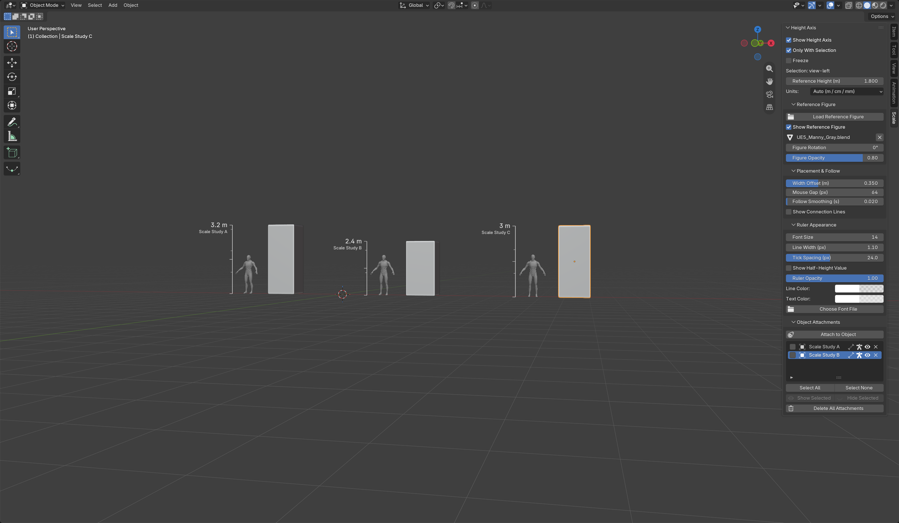

# Object Attachments

**English** · [简体中文](#简体中文)

Object attachments retain independent references while the live selection/mouse guide continues.

In 1.5.0, **Only With Selection** filters only the live guide. Visible saved attachments continue displaying after deselection. New attachments capture **Show Half-Height Value** (default off); records created in 1.4.0 without that field retain their original visible midpoint value.

## Keep a reference beside an object

1. Enable the ruler, the reference figure, or both. Choose the appearance and figure height you want to retain.
2. Select a geometric object in Object Mode. With multiple objects selected, the **active object** is the target.
3. Open **N → Scale → Object Attachments** and click **Attach to Object**.
4. Select another object or deselect everything. The attachment stays beside its target while the usual live selection/mouse guide continues independently. Repeat to retain references beside more objects.

Attachments follow their target's evaluated world bounds as it moves, rotates, scales or changes height. They remain on the current viewport-left side with the captured width offset and follow smoothing. Figure height stays a physical reference height rather than scaling with the target. Each attachment captures the enabled ruler/figure choices, reference mesh, units, font, colors, opacity, tick spacing and placement settings at creation. Changing the live settings or replacing/removing the live figure does not change previous attachments.

## List actions

| Control | Behavior |
| --- | --- |
| Left checkbox | Include the row in batch operations; it does not select the target object |
| Ruler / figure icons | Show what was captured in that entry |
| Eye | Toggle one entry's visibility |
| Select All / Select None | Check or uncheck the batch selection |
| Show Selected / Hide Selected | Change only checked entries |
| Row X | Remove that attachment record |
| Delete All Attachments | Remove all attachment records in this scene |

Removal never deletes, unlinks or hides target objects. Attachment creation, removal and batch visibility operations support Blender Undo. Records, visibility and captured appearance save with the blend file; no extra selectable scene objects are created and attachments do not appear in final renders.

## Attachment versus Freeze

An attachment follows an **object** and adjusts to the current view. **Freeze** pins only the live guide at a **world position**. Creating an attachment does not toggle Freeze, and freezing the live guide does not stop object attachments. Turning off the live display checkboxes leaves stored visible attachments active; use the list to hide them. Viewport **Overlays** controls both live and attached guides.

Targets retain their bindings when renamed. Hidden targets and targets outside the current view layer are skipped. Deleted or unlinked targets leave a missing-target record that can be removed from the list. Each scene has its own list. A saved font path is still an external dependency, with the existing default-font fallback when unavailable.

Default review and saved handoff views use non-isometric perspective. The example is a native Blender viewport capture of locally generated study objects and Epic's gray UE Manny; see [source and license](UE_MANNEQUIN.md).

---

## 简体中文

物体绑定在原目标旁持续保留独立参照，实时选中/鼠标跟随继续工作。

1.5.0 的**仅选中时显示**只过滤实时参照，取消选择后可见的旧绑定继续显示。新绑定保存**显示半高数值**开关（默认关闭）；1.4.0 旧记录缺少该字段时保留原来的中位数值。

### 在物体旁持续保留参照

1. 开启尺子、参考人物或二者，设置要保留的外观与参考身高。
2. 在对象模式选择几何物体；多选时以**活动物体**作为绑定目标。
3. 打开 **N → Scale → 物体绑定参照**，点击**绑定到物体**。
4. 切换选择或取消选择。旧绑定仍跟随原目标，原有选中/鼠标实时参照继续独立运行。重复操作可在多个物体旁留下参照。

目标移动、旋转、缩放或高度变化时，绑定使用评估后的世界范围更新，在当前视口左侧按创建时的宽度偏移与缓动设置跟随。人物保持独立的物理参考身高，不随目标缩放。每条记录保存创建时的尺子/人物开关、人物网格、单位、字体、颜色、不透明度、刻度间距及放置设置；后续改变实时设置、更换或移除实时人物都不会改变旧绑定。

### 列表操作

| 控件 | 行为 |
| --- | --- |
| 左侧勾选框 | 加入批量操作，不选中场景目标 |
| 尺子/人物图标 | 表明该条目保留了哪些参照 |
| 眼睛 | 独立切换一条记录的可见性 |
| 全选/全不选 | 勾选或取消全部批量选择 |
| 显示所选/隐藏所选 | 只改变已勾选条目 |
| 行末 X | 移除当前绑定记录 |
| 删除全部绑定 | 清除本场景的全部绑定记录 |

删除记录不会删除、解除链接或隐藏目标物体。创建、移除和批量显隐支持 Blender 撤销。绑定、可见性及创建时的外观随 blend 文件保存；不会产生可选中的普通场景对象，也不进入最终渲染。

### 绑定与停止跟随的区别

绑定跟随**目标物体**并适应当前视角；**停止跟随 / Freeze** 只把实时参照固定在**世界位置**。创建绑定不会切换 Freeze，实时冻结也不会停止已有对象绑定。关闭实时显示开关后，可见的旧绑定继续显示；通过列表隐藏它们。视口 **Overlays** 同时控制实时和绑定参照。

目标改名后绑定保留；目标隐藏或不在当前视图层时跳过。删除目标或把目标从当前场景移走后，列表保留失效记录，可自行移除。每个场景拥有独立列表。字体路径仍是外部依赖，缺失时继续使用默认字体回退。

上方原生 Blender 视口截图展示两个绑定与一套独立实时参照，示例物体在本地生成，灰色 Manny 来自 Epic UE 模板，详见[来源与许可](UE_MANNEQUIN.md)。默认审查和保存交付视角使用非等距透视。
