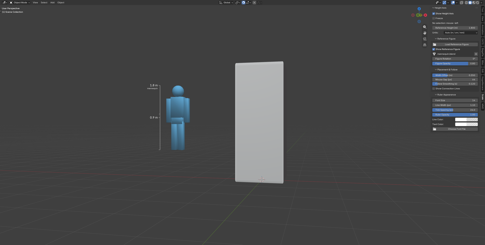
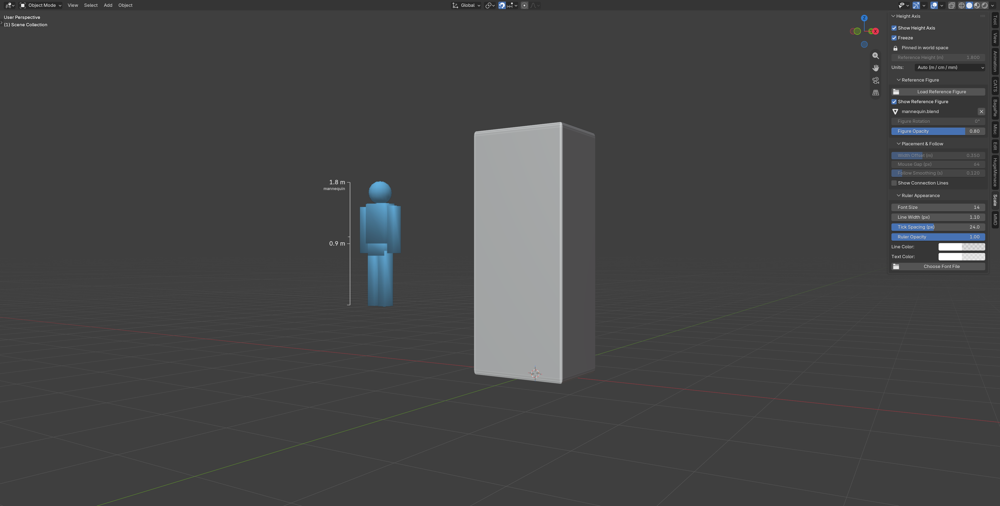
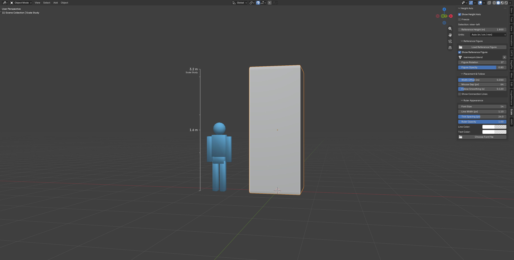
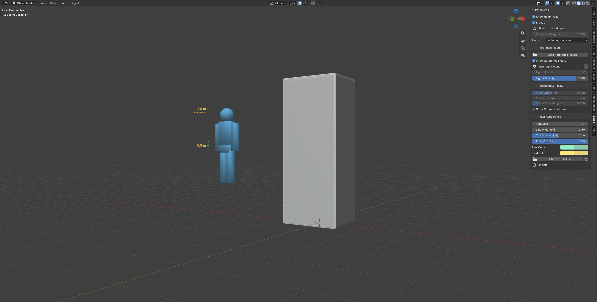
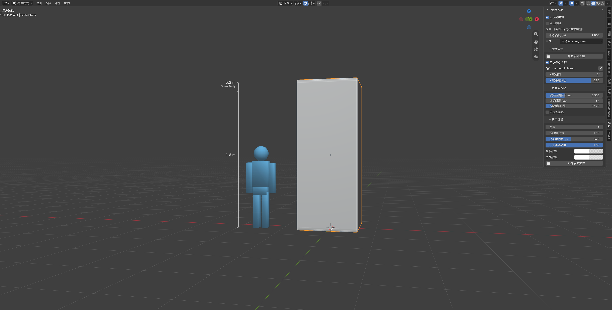

# Visual Guide

**English** · [简体中文](#简体中文)

## Selection: measure and compare

The translucent white ruler shows the selection's world-Z height, with only half-height and full-height values on its left. A smaller object name accompanies the full height. The blue figure keeps its own reference height. Both follow the viewport-left side smoothly as the view rotates. Zooming out fades the ruler and figure into a single height readout and name; zooming in reveals decimal ticks down to 1 mm. Automatic unit handoffs show one reading at a time.

## Mouse: move the reference

With nothing selected, the translucent white ruler and blue figure follow the mouse on the left. This is useful for quick scale comparisons without adding a scene object.

## Freeze: keep a location

**Freeze** pins both guides in world space. The checked control and locked geometry settings indicate the state. Viewport orbit changes how that fixed location appears on screen. There is no bottom caption on the ruler.

## Controls

Visibility, Freeze, reference height and units stay in the main panel. Model loading and figure settings are grouped under **Reference Figure**. **Placement & Follow** and **Ruler Appearance** collapse independently.

| Control | Purpose |
| --- | --- |
| Show Height Axis | Ruler visibility |
| Freeze | Capture or release world-space placement |
| Reference Height (m) | Physical height of the mouse ruler and reference figure |
| Width Offset (m) / Mouse Gap (px) | Physical selection offset / screen-space mouse gap |
| Follow Smoothing (s) / Show Connection Lines | Following response and optional connectors |
| Units / Font Size | Measurement formatting and label size |
| Line Width (px) | Main line width; crossbars stay thinner |
| Tick Spacing (px) | Minimum screen spacing before minor ticks fade in; larger values are sparser, default 24 |
| Ruler Opacity | Overall ruler and text opacity |
| Line Color / Text Color | Independent RGBA colors, including opacity |
| Choose Font File / reset icon | Use a local TTF, OTF or TTC font, or restore Blender's default |
| Load Reference Figure | Choose a supported model file |
| Show Reference Figure | Figure visibility, independently from the ruler |
| Figure Rotation / Opacity | Reference pose direction and visual strength |
| Remove Reference Figure | Clear the loaded reference |

Minor tick spacing changes the visibility of exact physical decimal levels rather than stretching their distances. It saves with the scene and stays editable while frozen. All crossbars, including both endpoints and half-height, extend horizontally only to screen-left from the axis.

The screenshots are exported from a real Blender viewport. New previews default to non-isometric perspective, preferably eye-level with a modest horizontal turn. The study object and mannequin are generated locally by this project. No illustration is presented as an application screenshot.

---

## 简体中文

### 选中、跟随与冻结

第一张图为选中物体：白色半透明尺子显示世界 Z 高度，左侧只标注半高与全高，全高下方带较小的物体名称；蓝色人物保持独立的参考身高。它们在当前视口中平滑跟随目标左侧。拉远时尺子与人物渐隐为一个高度数值及名称，拉近时逐层显示最细到 1 mm 的十进制刻度；自动单位切换只显示一套读数。

第二张图为鼠标跟随：未选中物体时，白色半透明尺子和蓝色人物在鼠标左侧移动，用于快速比较尺度，不需要添加场景对象。

第三张图为冻结：Freeze 勾选后，两种参照固定在世界三维位置。复选框和锁定的几何参数显示当前状态；旋转视角只改变固定位置的投影，尺子底部不再显示说明文字。

### 控件

主面板保留显示、冻结、参考身高和单位。模型加载与人物参数归入“参考人物”；“放置与跟随”和“尺子外观”可独立折叠。

| 控件 | 用途 |
| --- | --- |
| Show Height Axis / 显示高度轴 | 控制尺子显示 |
| Freeze / 停止跟随 | 捕获或解除三维固定位置 |
| Reference Height (m) / 参考高度 | 鼠标参考尺与人物的真实身高，单位为米 |
| Width Offset (m) / Mouse Gap (px) | 选中范围的实际偏移 / 鼠标屏幕间距 |
| Follow Smoothing (s) / Show Connection Lines | 跟随缓动与可选连接线 |
| Units / Font Size | 数值单位与标签字号 |
| Line Width (px) / 线粗细 | 主线宽度，横向刻度保持更细 |
| Tick Spacing (px) / 小刻度间距 | 小刻度开始渐显的最小屏幕间距；数值越大越稀疏，默认 24 |
| Ruler Opacity / 尺子不透明度 | 尺子与文字的整体不透明度 |
| Line Color / Text Color | 线与文字独立的 RGBA 颜色，包含透明度 |
| Choose Font File / 重置图标 | 选择本地 TTF、OTF、TTC 字体，或恢复默认字体 |
| Load Reference Figure / 加载参考人物 | 选择支持的模型文件 |
| Show Reference Figure / 显示参考人物 | 独立控制人物显示 |
| Figure Rotation / Opacity | 人物朝向与不透明度 |
| Remove Reference Figure / 移除参考人物 | 清除已加载的参照 |

小刻度间距只改变准确十进制刻度层级的显隐，不拉伸实际物理距离。设置随场景保存，冻结后仍可调整。全部横线，包括上下端与半高，都只从竖线水平向屏幕左侧延伸。上方新预览展示默认稀疏刻度与调节控件。

所有截图都从真实 Blender 视口导出。新预览默认非等距透视，优先平视并适度水平侧转。示例物体和人物由本项目在本地生成，没有将绘制的示意图当作软件截图。
